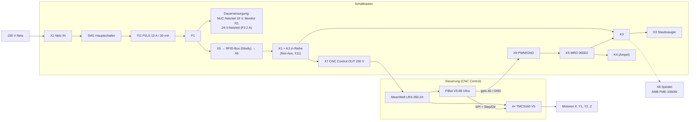

# Verdrahtung Holz-CNC

Dieses Dokument beschreibt den **Schaltkasten** (Aufbau 2025, beim Umbau 2026
unverändert) und die **Anbindung der neuen Steuerung** (PiBot V5.88 Ultra mit
FluidNC, Umbau 2026).

Quellen:

- Schaltplan Schaltkasten: [`Wiring_Diagram/Wiring_Diagram.qet`](Wiring_Diagram/Wiring_Diagram.qet)
  (QElectroTech), Export als [`Wiring_Diagram.pdf`](Wiring_Diagram/Wiring_Diagram.pdf).
  Folio 1 = Schaltplan, Folio 2 = Steckverbinder und Kabel.
- Steuerungs-Konfiguration: [`../Controller/config.yaml`](../Controller/config.yaml)
- PiBot-Unterlagen: [`Controller/`](Controller/) (Schaltpläne, Abmessungen, Foto der Anordnung)
- Netzteil: [`Datenblaetter/MeanWell_LRS-350.pdf`](Datenblaetter/MeanWell_LRS-350.pdf)

Rasterangaben wie *(1-E13)* beziehen sich auf Folio 1, Zeile E, Spalte 13.

## Überblick

Die gestrichelte Verbindung K3 → X8 ist im Schaltplan noch nicht gezeichnet
(siehe [Offene Punkte](#offene-punkte)).

## Schaltkasten (unverändert)

### Bauteile

| BMK | Bauteil | Funktion |
|---|---|---|
| SW1 | EATON 041097 | Hauptschalter, 3-polig |
| FI1 | Siemens 5SU1356-6KK10 | FI/LS-Schalter 10 A, 30 mA |
| F1 | 179644 NB1L | Sicherung L/N |
| F3 | Feinsicherung 2 A | Absicherung 24-V-Netzteil |
| – | Netzteil 19 V DC | Versorgung NUC-PC |
| – | MeanWell HDR-30-24 | 24 V DC für Relais-Spulen, Not-Aus, Ampel, USB-Hub, Lüfter |
| K1, K2 | Installationsschütz 4 NO, Spule 24 V DC (im Plan als SIE 5TT5830-2 bezeichnet) | Freigabe 230 V zur Steuerung, zweikanalig über Not-Aus |
| K3, K4 | Finder 40.52.9.024.0000 auf Sockel 95.85.30 (24 V DC, 2 Wechsler) | K3: schaltet Staubsauger; K4: Ampel |
| K5 | MRD 060D2 | Koppelrelais, angesteuert von der Steuerung über X9 |
| – | NUC-PC, USB-Hub, Lüfter | Bedien-PC mit Monitor, Tastatur, Maus |

### Funktionen

**Netzversorgung.** X1 → SW1 → FI1 → F1. Danach liegen dauerhaft an: das
19-V-Netzteil (NUC), die Monitor-Steckdose X2 und über F3 das 24-V-Netzteil.

**Freigabe RFID.** Die Phase wird über X5 zur RFID-Box (Shelly) geführt und
kommt über X6 zurück. Ohne Freigabe durch die RFID-Box bleibt die Steuerung
stromlos.

**Not-Aus.** Der Not-Aus (M22-PV/KC02/IY, 2 Öffner) liegt an X11:
weiß = +24 V, braun → Spule K1, grün → Spule K2. K1 und K2 schalten L und N
in Reihe zu X7 *CNC Control OUT*. Not-Aus gedrückt → K1/K2 fallen ab → die
Steuerung (PiBot, Treiber) und alles, was hinter K1/K2 hängt, wird stromlos.
Die Öffner-Hilfskontakte von K1/K2 (21–22) gehen auf die Ampel.

**Spindel/Staubsauger.** Die Steuerung schaltet über X9 (weiß = Signal,
braun = GND) das Koppelrelais K5. Dessen Kontakt 13–14 legt +24 V auf die
Spulen von K3 und K4. K3 schaltet mit 11–14 und 21–24 L und N zur
Staubsauger-Steckdose X3 (abgegriffen hinter K1/K2). Trotz der Beschriftung
„PWM" ist X9 ein reines Ein/Aus-Signal.

**Ampel.** Die Signallampe an X10 (weiß, braun, grün; gelb = gemeinsamer GND)
wird über K4 (11–14/12) und die Hilfskontakte von K1/K2 versorgt. Welche
Farbe wann leuchtet, steht in Folio 1 (Bereich E14–F17).

### Steckverbinder (Folio 2)

| X | Bezeichnung | Gegenstelle | Kabel |
|---|---|---|---|
| X1 | Power In | Wandsteckdose | 230 V, 3×1,5 mm², Ø 11,2 mm |
| X2 | Monitor Out | Monitor | Kabel des Monitors |
| X3 | Staubsauger Out | Staubsauger | Kabel des Staubsaugers |
| X5 | RFID Out | RFID-Box | 230 V, 3×1,5 mm², Ø 8 mm, M16 |
| X6 | RFID In | RFID-Box | 230 V, 3×1,5 mm², Ø 8 mm, M16 |
| X7 | CNC Control Out | Steuerung (LRS-350-24) | 230 V, 3×1,5 mm² (0,75 mm² würde reichen), Ø 8 mm, M16 |
| X8 | Spindel Out | AMB FME-1050W | Kabel der Fräse, M16 |
| X9 | Spindel PWM | Steuerung (PiBot) | Signal 2×0,34 mm² (weiß, braun), Ø 4,9 mm, M16 |
| X10 | Lamp Out | Signallampe | Signal 4×0,34 mm² (weiß, braun, grün, gelb), Ø 5,7 mm, M16 |
| X11 | E-Stop | Not-Aus-Taster | Signal 4×0,34 mm² (weiß, braun, grün, gelb), Ø 5,7 mm, M16 |
| X12 | LAN Out | Switch | LAN |
| X13 | HDMI Out | Monitor | HDMI |
| X14 | USB | Maus | Kabel der Maus |
| X15 | USB | Tastatur | Kabel der Tastatur |
| X16 | USB | CNC Control | USB |
| X17 | USB | – (in Folio 2 nicht belegt) | |

Kabelverschraubungen M16: Lapp 53111210.

## Steuerung (neu, Umbau 2026)

Die originale X-Carve-Steuerung (GRBL 1.1h, alte Einstellungen in
[`../Controller/legacy/`](../Controller/legacy/grbl_1_1h_settings.md)) wurde
ersetzt durch:

| Bauteil | Funktion |
|---|---|
| MeanWell LRS-350-24 (24 V / 14,6 A) | Versorgung PiBot und Motortreiber, gespeist aus X7 |
| PiBot V5.88 Ultra (ESP32-S3, FluidNC) | Steuerung, WLAN-Web-UI, SD-Karte |
| 4× PiBot SilentStep TMC5160 V5 | Schrittmotortreiber X, Y1, Y2, Z (extern, SPI) |

Anordnung der Bauteile: [`Controller/Anordnung_Bauteile.jpg`](Controller/Anordnung_Bauteile.jpg).

### Schnittstelle Schaltkasten ↔ Steuerung

| Schaltkasten | Ader | Steuerung | Hinweis |
|---|---|---|---|
| X7 L | braun | LRS-350-24 L | 230 V nur bei RFID-Freigabe und nicht gedrücktem Not-Aus |
| X7 N | blau | LRS-350-24 N | |
| X7 PE | grün/gelb | LRS-350-24 ⏚ | |
| X9 Signal | weiß | PiBot `gpio.46` (5-V-Ausgang) | `M3 S>0` = Ein, `M5` = Aus; aus bei Alarm |
| X9 GND | braun | PiBot GND | |

**Nicht** an `gpio.6` anschließen: das ist der 0–10-V-Analogausgang (für VFDs)
und liefert keinen zuverlässigen Schaltpegel.

Der Not-Aus ist nicht als Eingang an den PiBot geführt. Er wirkt, indem er der
Steuerung die 230 V wegnimmt. Danach startet der PiBot neu und die Position ist
verloren: **nach jedem Not-Aus neu referenzieren (`$H`)**.

### PiBot V5.88 Ultra – Pinbelegung

| Funktion | Pin | Hinweis |
|---|---|---|
| SPI-Bus | MOSI `gpio.1`, MISO `gpio.2`, SCK `gpio.21` | gemeinsam für alle TMC5160 |
| SD-Karte | CS `gpio.9` | |
| I2S (Step/Dir-Expander) | BCK `gpio.16`, WS `gpio.18`, DATA `gpio.17` | |
| Endschalter X − | `gpio.42` | Optokoppler-Eingang, active-low |
| Endschalter Y1 − | `gpio.40` | |
| Endschalter Y2 − | `gpio.39` | zweite Y-Seite (Auto-Squaring) |
| Endschalter Z + | `gpio.38` | oberer Schalter |
| Taster 3D-Touch-Probe | `gpio.41` | active-low |
| Werkzeuglängensensor | `gpio.37` | |
| Überfahrschutz Werkzeuglängensensor | `gpio.36` | Öffner gegen GND, löst Fault-Alarm aus |
| Schutztür (nur `config_door.yaml`) | `gpio.48` | Eingang des freien C-Endschalters, Kontakt bei geschlossener Tür geschlossen |
| Spindel-Freigabe → X9 | `gpio.46` | 5-V-Header |
| OLED (derzeit deaktiviert) | SCL `gpio.13`, SDA `gpio.14` | nur mit eigener Firmware |

### Motortreiber TMC5160 (SPI unabhängig)

Alle Treiber hängen am gemeinsamen MOSI/SCK/MISO und haben jeweils eine eigene
CS-Leitung (keine Daisy-Chain, `spi_index: -1`). Die CS-Leitung für X liegt auf
dem SPI-Signalheader, die für Y1/Y2/Z auf den MS3-Pins der (leeren)
StepStick-Sockel. Der 3-Jumper-SPI-Block (Position ⑯) wird nicht benutzt.

| Achse | Step | Dir | Disable | CS |
|---|---|---|---|---|
| X | `I2SO.2` | `I2SO.1` | `I2SO.0` | `I2SO.3` |
| Y1 | `I2SO.5` | `I2SO.4` | `I2SO.7` | `I2SO.6` |
| Y2 | `I2SO.10` | `I2SO.9` | `I2SO.8` | `I2SO.11` |
| Z | `I2SO.13` | `I2SO.12` | `I2SO.15` | `I2SO.14` |

Treibereinstellungen: `r_sense_ohms: 0.1`, 2,8 A Lauf- und 1,4 A Haltestrom,
16 Mikroschritte. Schaltplan des Treibers:
[`Controller/PiBot_TMC5160_Schaltplan.pdf`](Controller/PiBot_TMC5160_Schaltplan.pdf).

## Spindel AMB FME-1050W

- 230 V, wird über X8 versorgt und von der Steuerung nur ein- und
  ausgeschaltet (FluidNC-Spindeltyp `Relay`).
- Die Drehzahl wird **von Hand am Stellrad der Fräse** eingestellt. S-Werte im
  G-Code (z. B. aus Fusion) schalten nur ein/aus.
- Aufnahme: 43-mm-Spannhals, Halter siehe [`Spindel/Spindelhalter_43mm.png`](Spindel/Spindelhalter_43mm.png).

## Offene Punkte

- **X8 im Schaltplan nachtragen.** In Folio 1 ist X8 nicht eingezeichnet. Seit
  „fix schaubsauger connection" (2025-03-31) schaltet K3 dort nur X3. K3 hat
  zwei Wechsler, beide für X3 belegt. Am Schaltkasten prüfen, woher X8
  seine geschaltete 230 V bekommt, und dann QET/PDF aktualisieren.
- **K1/K2-Beschriftung.** Das Siemens 5TT5830-2 (24 V AC) war eine Fehlbestellung
  (siehe [`../Rechnungen/Reichelt/Readme.md`](../Rechnungen/Reichelt/Readme.md)).
  Verbaut sind die Schütze von Schütz24; das Bauteil im Plan anpassen.
- **Steuerungsseite in QElectroTech.** Die PiBot-Verdrahtung oben steht bisher
  nur in diesem Dokument. Sinnvoll wäre ein Folio 3 im Schaltplan.
- **Ampel-Farben** hier dokumentieren, sobald sie an der Maschine geprüft sind.
