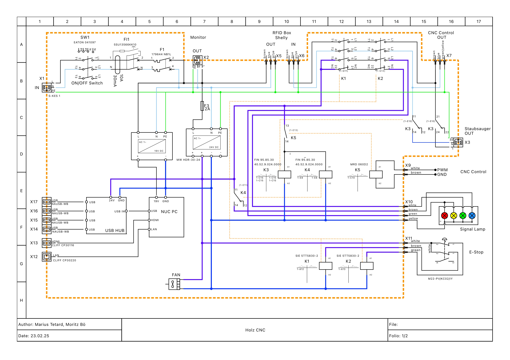

# Holz-CNC

Dokumentation der Holz-CNC im FREILab: Schaltkasten, Steuerung, Fräse,
3D-Druckteile und Rechnungen. Dieses Repo ist die zentrale Quelle für den
Aufbau der Maschine.

| Komponente | Stand |
|---|---|
| Mechanik | X-Carve-Nachbau 1000 mm, XYYZ (zwei Y-Motoren) – [Original CNC + Controller](https://makerstore.krilano.com/product/full-parts-bundle-to-build-an-x-carve-style-cnc/) |
| Schaltkasten | Aufbau 2025: RFID-Freigabe, Not-Aus, Ampel, Staubsauger, NUC-PC |
| Steuerung | Umbau 2026: PiBot V5.88 Ultra mit FluidNC, 4× TMC5160 V5, MeanWell LRS-350-24 |
| Fräse | AMB FME-1050W, 43-mm-Spannhals, ein/aus über die Steuerung |

## Inhalt

| Ordner | Inhalt |
|---|---|
| [`HW/Verdrahtung.md`](HW/Verdrahtung.md) | **Verdrahtung**: Schaltkasten, Anschlüsse, Schnittstelle zur PiBot-Steuerung, Pinbelegung |
| [`HW/Wiring_Diagram/`](HW/Wiring_Diagram/) | Schaltplan Schaltkasten ([QElectroTech](https://qelectrotech.org/) + PDF) |
| [`HW/Controller/`](HW/Controller/) | PiBot-Schaltpläne, Abmessungen, Foto der Bauteilanordnung |
| [`HW/Spindel/`](HW/Spindel/) | Zeichnung Spindelhalter 43 mm |
| [`HW/Datenblaetter/`](HW/Datenblaetter/) | Datenblätter (MeanWell LRS-350) |
| [`3D/Schaltkasten/`](3D/Schaltkasten/) | 3D-Druckteile Schaltkasten und Maschine (Fusion `.f3d` + `.stl`/`.3mf`) |
| [`3D/Pibot-Kasten/`](3D/Pibot-Kasten/) | Gehäuse der PiBot-Steuerung inkl. Halterungen (Fusion-Archiv `HolzCNC-PiBot-Rebuild-Box.f3d`), Druckdateien `PiBot+TMC_Mount.3mf` und `Kabeldurchführung.3mf` |
| [`Controller/`](Controller/) | **FluidNC-Konfiguration**, Postprozessor, Validator, Firmware-Notizen |
| [`Rechnungen/`](Rechnungen/) | Rechnungen und Fehlbestellungen |

## Schaltplan Schaltkasten

Folio 2 (Steckverbinder und Kabel) steht im
[PDF](HW/Wiring_Diagram/Wiring_Diagram.pdf). Wenn sich der Schaltplan ändert,
die `.qet` bearbeiten, PDF exportieren und `Wiring_Diagram.jpg` neu erzeugen.

## Umbau 2026

Die originale X-Carve-Steuerung (GRBL) wurde durch einen PiBot V5.88 Ultra mit
FluidNC ersetzt, die Fräse durch eine AMB FME-1050W. Der Schaltkasten blieb
unverändert. Die Steuerung bekommt ihre 230 V über X7 (nach RFID-Freigabe und
Not-Aus) und schaltet Fräse und Staubsauger über X9. Details:
[`HW/Verdrahtung.md`](HW/Verdrahtung.md) und [`Controller/README.md`](Controller/README.md).

Die FluidNC-Konfiguration lag vorher im Repo `FREILab/fluidnc-configs` und
wurde hierher übernommen.

## Fragen?

Bei Fragen wendet euch bitte an das Holz-CNC Team (Slack/Mattermost) oder die
Maintainer dieses Repos.
